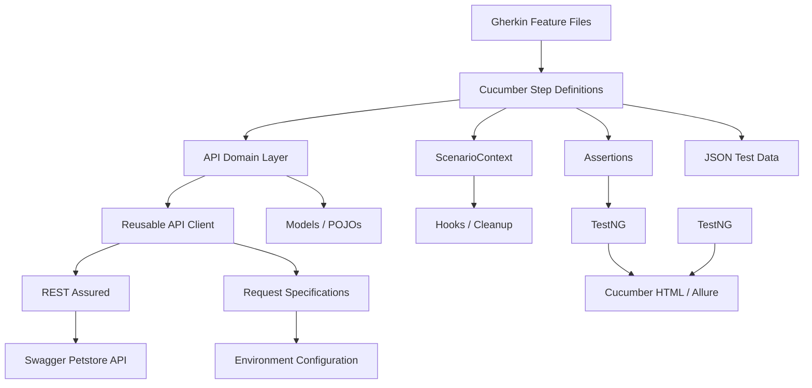

# 🐾 Petstore API Automation Framework

<p align="center">
  <strong>Enterprise-style API test automation framework for the Swagger Petstore API</strong><br/>
  Built with Java 17, REST Assured, Cucumber, TestNG, Maven, Allure, and GitHub Actions.
</p>

<p align="center">
  
  
  
  
  
  
  
</p>

---

## 📌 Table of Contents

- [Overview](#-overview)
- [Key Capabilities](#-key-capabilities)
- [Technology Stack](#-technology-stack)
- [API Coverage](#-api-coverage)
- [Test Coverage](#-test-coverage)
- [Framework Architecture](#-framework-architecture)
- [Project Structure](#-project-structure)
- [Test Design](#-test-design)
- [Configuration and Environments](#-configuration-and-environments)
- [Test Data Strategy](#-test-data-strategy)
- [Request and Response Handling](#-request-and-response-handling)
- [Assertions](#-assertions)
- [Scenario Context and Test Data Cleanup](#-scenario-context-and-test-data-cleanup)
- [Retry Strategy](#-retry-strategy)
- [Reports](#-reports)
- [How to Run](#-how-to-run)
- [Cucumber Tags](#-cucumber-tags)
- [CI/CD](#-cicd)
- [Recommended Repository Hygiene](#-recommended-repository-hygiene)
- [Important Current-State Notes](#-important-current-state-notes)
- [Recommended Next Improvements](#-recommended-next-improvements)
- [Author](#-author)

---

## 🧭 Overview

This project is a **BDD-oriented API automation framework** designed to test the public **Swagger Petstore API** through reusable Java API clients, Cucumber feature files, TestNG execution, REST Assured HTTP communication, centralized configuration, externalized JSON test data, reusable assertions, automatic cleanup, retry handling, and CI execution.

The framework covers the major Petstore domains:

- 🐕 Pet
- 🏪 Store
- 👤 User
- 🔄 End-to-end regression workflows

The test suite intentionally includes more than simple happy-path API checks. Scenarios cover **positive, negative, edge, boundary, validation, security-oriented, smoke, and regression** behavior.

### 🎯 Primary Goals

- Validate API behavior through readable BDD scenarios.
- Separate test intent from HTTP implementation.
- Centralize API communication and request specifications.
- Externalize reusable test data.
- Support multiple request formats such as JSON, XML, and form-encoded requests.
- Validate status codes, response content, headers, and response-time expectations.
- Clean up test-created data automatically.
- Support retries for transient failures.
- Produce CI-friendly test artifacts and reports.

---

## ✨ Key Capabilities

| Capability | Implementation |
|---|---|
| API automation | REST Assured |
| BDD | Cucumber |
| Test execution | TestNG + Maven |
| Language | Java 17 |
| Test data | JSON + Java Faker |
| Serialization | Jackson |
| Request specifications | Centralized REST Assured specifications |
| Assertions | TestNG + reusable `ApiAssertions` |
| Scenario state | Thread-local `ScenarioContext` |
| Test cleanup | Cucumber `@After` hook |
| Retry | TestNG `IRetryAnalyzer` + annotation transformer |
| Reporting | Cucumber HTML + Allure dependencies/results |
| CI/CD | GitHub Actions |
| Environment selection | Maven system property / properties files |
| Schema validation | REST Assured JSON Schema Validator |
| Logging | SLF4J + Logback |
| XML support | Jackson XML + JAXB |

---

## 🧰 Technology Stack

| Technology | Version | Purpose |
|---|---:|---|
| Java | 17 | Programming language/runtime |
| Maven | — | Build and dependency management |
| REST Assured | 5.5.6 | API request/response automation |
| Cucumber | 7.18.1 | BDD feature execution |
| TestNG | 7.10.2 | Test execution and assertions |
| Jackson | 2.17.2 | JSON/XML serialization and parsing |
| Selenium Java | 4.25.0 | Present as a project dependency |
| Java Faker | 1.0.2 | Dynamic test data generation |
| Allure | 2.29.0 | Test reporting |
| SLF4J | 2.0.16 | Logging API |
| Logback | 1.5.15 | Logging implementation |
| GitHub Actions | — | Continuous integration |

---

## 🐾 API Coverage

### Pet API

The Pet domain is the largest area of coverage.

| Operation | Endpoint | Coverage |
|---|---|---|
| Create pet | `POST /pet` | JSON, XML, form, positive/negative/edge |
| Get pet | `GET /pet/{petId}` | Positive, negative, invalid IDs, boundaries |
| Update pet | `PUT /pet` | JSON, XML, positive/negative/edge |
| Update pet fields | `POST /pet/{petId}` | Form-encoded updates |
| Delete pet | `DELETE /pet/{petId}` | Positive, negative, API key, boundary |
| Find by status | `GET /pet/findByStatus` | Valid/invalid/empty/uppercase status |
| Find by tags | `GET /pet/findByTags` | Single/multiple/duplicate/special tags |
| Upload image | `POST /pet/{petId}/uploadImage` | File, metadata, invalid/edge cases |

### Store API

| Operation | Endpoint | Coverage |
|---|---|---|
| Inventory | `GET /store/inventory` | API key, invalid/missing key, response validation |
| Create order | `POST /store/order` | JSON, XML, form, status validation, boundaries |
| Get order | `GET /store/order/{orderId}` | Existing/nonexistent/invalid/boundary IDs |
| Delete order | `DELETE /store/order/{orderId}` | Existing/nonexistent/invalid IDs |

### User API

| Operation | Endpoint | Coverage |
|---|---|---|
| Create user | `POST /user` | JSON, XML, form, invalid/edge data |
| Create users | `POST /user/createWithList` | Single/multiple/empty/invalid/large lists |
| Get user | `GET /user/{username}` | Positive, negative, security-oriented inputs |
| Update user | `PUT /user/{username}` | JSON, XML, form, edge cases |
| Delete user | `DELETE /user/{username}` | Positive, negative, invalid/security inputs |
| Login | `GET /user/login` | Valid/invalid credentials, headers, edge cases |
| Logout | `GET /user/logout` | Normal, repeated, login/logout workflows |

---

## 📊 Test Coverage

The uploaded framework contains **19 feature files** with **161 Gherkin scenarios**.

### Scenario distribution by feature

| Feature | Scenarios |
|---|---:|
| Pet — Add | 13 |
| Pet — Delete | 8 |
| Pet — Find by Status | 5 |
| Pet — Find by Tags | 7 |
| Pet — Get | 6 |
| Pet — Update | 10 |
| Pet — Upload Image | 9 |
| End-to-End Regression | 23 |
| Store — Create Order | 9 |
| Store — Delete Order | 4 |
| Store — Get Order | 5 |
| Store — Inventory | 5 |
| User — Create | 10 |
| User — Create List | 6 |
| User — Delete | 7 |
| User — Get | 7 |
| User — Login | 13 |
| User — Logout | 5 |
| User — Update | 9 |
| **Total** | **161** |

### Coverage by test intent

| Tag | Scenarios |
|---|---:|
| `@regression` | 52 |
| `@edge` | 34 |
| `@positive` | 32 |
| `@negative` | 32 |
| `@security` | 21 |
| `@smoke` | 20 |
| `@validation` | 14 |
| `@boundary` | 7 |

> **Note:** Tags are not mutually exclusive, so the category totals intentionally exceed 161 when added together.

---

## 🏗️ Framework Architecture

The framework follows a layered design:



### Architectural flow

```text
Feature
   ↓
Step Definition
   ↓
Domain API Class
   ↓
ApiClient
   ↓
REST Assured
   ↓
Petstore API
   ↓
Response
   ↓
Assertions
   ↓
ScenarioContext
   ↓
Cleanup / Reporting
```

This separation makes it easier to:

- Add new endpoints.
- Reuse HTTP functionality.
- Keep feature files readable.
- Centralize configuration.
- Maintain API models independently.
- Reuse assertions and scenario state.

---

## 📁 Project Structure

```text
PETSTROE_API_5_cld/
│
├── .github/
│   └── workflows/
│       └── api-tests.yml
│
├── src/
│   └── test/
│       ├── java/
│       │   └── com/petstore/api/
│       │       │
│       │       ├── api/
│       │       │   ├── ApiClient.java
│       │       │   ├── PetApi.java
│       │       │   ├── StoreApi.java
│       │       │   └── UserApi.java
│       │       │
│       │       ├── assertions/
│       │       │   └── ApiAssertions.java
│       │       │
│       │       ├── clients/
│       │       │   ├── BaseApiClient.java
│       │       │   └── PetApiClient.java
│       │       │
│       │       ├── config/
│       │       │   └── Config.java
│       │       │
│       │       ├── constants/
│       │       │   └── ApiConstants.java
│       │       │
│       │       ├── hooks/
│       │       │   └── Hooks.java
│       │       │
│       │       ├── listeners/
│       │       │   └── RetryTransformer.java
│       │       │
│       │       ├── models/
│       │       │   ├── ApiResponse.java
│       │       │   ├── Category.java
│       │       │   ├── Order.java
│       │       │   ├── Pet.java
│       │       │   ├── Tag.java
│       │       │   └── User.java
│       │       │
│       │       ├── runners/
│       │       │   └── TestRunner.java
│       │       │
│       │       ├── specifications/
│       │       │   └── ApiSpecifications.java
│       │       │
│       │       ├── stepdefinitions/
│       │       │   ├── BaseSteps.java
│       │       │   ├── PetSteps.java
│       │       │   ├── StoreSteps.java
│       │       │   └── UserSteps.java
│       │       │
│       │       └── utils/
│       │           ├── FakerUtils.java
│       │           ├── JsonDataReader.java
│       │           ├── RetryAnalyzer.java
│       │           └── ScenarioContext.java
│       │
│       └── resources/
│           ├── config.properties
│           ├── config/
│           │   ├── qa.properties
│           │   ├── sit.properties
│           │   └── uat.properties
│           │
│           ├── features/
│           │   ├── pet/
│           │   ├── store/
│           │   ├── user/
│           │   └── regression/
│           │
│           ├── schemas/
│           │   └── pet-response-schema.json
│           │
│           └── testdata/
│               └── petstore_test_data.json
│
├── pom.xml
├── TestNG.xml
└── README.md
```

> Generated build output such as `target/` and generated report files should generally not be committed to source control.

---

## 🧪 Test Design

The framework deliberately tests API behavior across multiple dimensions.

### ✅ Positive testing

Examples include:

- Creating valid pets, users, and orders.
- Retrieving existing resources.
- Updating existing resources.
- Successful authentication.
- Valid inventory access.

### ❌ Negative testing

Examples include:

- Nonexistent resource IDs.
- Invalid usernames.
- Invalid credentials.
- Invalid request data.
- Invalid status values.
- Invalid API keys.

### ⚠️ Edge-case testing

Examples include:

- Empty request bodies.
- Empty objects.
- Empty arrays.
- Empty parameters.
- Duplicate values.
- Special characters.
- Unicode values.
- Very large collections.
- Repeated logout operations.

### 📏 Boundary testing

Examples include:

- `0`
- `-1`
- Maximum Java `int`
- Maximum `int64`
- Large quantities
- Large user lists

### 🔐 Security-oriented testing

The suite includes lightweight API robustness/security scenarios involving:

- Injection-like IDs.
- Injection-like usernames.
- Injection-like passwords.
- Path traversal-like usernames.
- Invalid API keys.
- Missing API keys.
- Malicious metadata.
- Ensuring malformed inputs do not cause unexpected `5xx` responses.

> These scenarios are **API robustness checks**, not a substitute for a dedicated penetration/security testing program.

---

## ⚙️ Configuration and Environments

The framework uses a centralized `Config` utility.

### Default configuration

`src/test/resources/config.properties`

```properties
base.url=https://petstore.swagger.io/v2
api.key=special-key

connection.timeout=10000
response.timeout=15000
```

Environment-specific property files are also provided:

```text
src/test/resources/config/
├── qa.properties
├── sit.properties
└── uat.properties
```

Each environment currently defines the Petstore base URL and environment name.

### Configuration precedence

The `Config` class first checks Java system properties and then falls back to `config.properties`.

That means command-line values can override defaults:

```bash
mvn clean test -Denv=qa
```

or, where a specific configuration key is supported:

```bash
mvn clean test -Dbase.url=https://petstore.swagger.io/v2
```

### Default API

```text
https://petstore.swagger.io/v2
```

### API key

```text
special-key
```

For real projects, secrets should be supplied through environment variables or CI secret storage rather than committed to source control.

---

## 🗃️ Test Data Strategy

Test data is primarily externalized in:

```text
src/test/resources/testdata/petstore_test_data.json
```

The data is organized by API domain and test intent:

```text
pet
├── positive
├── negative
├── edge
├── boundary
├── findByStatus
├── findByTags
└── uploadImage

store
├── inventory
└── order

user
├── positive
├── negative
└── edge
```

This approach keeps large request payloads and test values out of step-definition code.

### Dynamic test data

`FakerUtils` provides dynamically generated values such as:

- Pet names
- Unique pet names
- UUID-based photo URLs

Dynamic IDs are also used in selected negative scenarios to reduce collisions against the shared public demo environment.

---

## 🔌 Request and Response Handling

The framework contains a reusable `ApiClient` abstraction that supports:

```text
GET
POST
PUT
DELETE
```

It also supports:

- Query parameters
- Headers
- JSON request bodies
- XML request bodies
- Form-urlencoded data
- File uploads
- Raw request payloads

Example usage conceptually follows:

```java
Response response = apiClient.post("/pet", pet);
```

Domain-specific classes such as `PetApi`, `StoreApi`, and `UserApi` sit above the generic HTTP client.

This prevents step definitions from becoming tightly coupled to low-level REST Assured implementation details.

---

## 🧱 Models

Request/response payloads are represented using Java models such as:

```text
Pet
Category
Tag
Order
User
ApiResponse
```

Jackson is used for object serialization/deserialization and XML support.

---

## 🎯 Assertions

Reusable API assertions are centralized in:

```text
com.petstore.api.assertions.ApiAssertions
```

Available assertion helpers include:

```java
statusCode(response, expected);
successful(response);
clientError(response);
fieldExists(response, "field");
responseTimeUnder(response, milliseconds);
```

Step definitions also provide common checks such as:

- Exact status code validation.
- No unexpected `5xx` response.
- Response ID extraction.
- JSON-success detection.

Centralizing assertions reduces duplication and keeps test steps readable.

---

## 🔄 Scenario Context and Test Data Cleanup

The framework uses a thread-local `ScenarioContext` to store scenario-specific information such as:

```text
petId
orderId
username
response
```

This enables multi-step workflows such as:

```text
Create Pet
   ↓
Capture Pet ID
   ↓
Update Pet
   ↓
Retrieve Pet
   ↓
Delete Pet
```

### Automatic cleanup

The Cucumber `Hooks` class performs cleanup after each scenario.

It attempts to remove:

- Created pets
- Created orders
- Created users

This is particularly important because the tests interact with a shared public demo API.

---

## 🔁 Retry Strategy

The framework includes a TestNG retry mechanism:

```text
RetryTransformer
       ↓
RetryAnalyzer
       ↓
Maximum retry attempts
```

The current `RetryAnalyzer` allows up to **2 retry attempts after the initial execution**.

Retries can help mitigate transient failures commonly seen when testing a public/shared API.

> Retries should be used carefully. They should not mask deterministic application defects.

---

## 📊 Reports

The framework includes multiple reporting mechanisms.

### Cucumber HTML

The current runner configures:

```text
target/cucumber-reports.html
```

### Allure

The project includes the Allure Cucumber 7 integration dependency and generated Allure result artifacts.

Typical Allure usage is:

```bash
allure serve allure-results
```

or:

```bash
allure generate allure-results -o allure-report --clean
allure open allure-report
```

> Allure CLI installation is required separately if it is not already available on the machine.

### Maven/TestNG reports

Maven Surefire/TestNG results are generated beneath:

```text
target/surefire-reports/
```

---

## ▶️ How to Run

### 1. Prerequisites

Install:

- Java 17+
- Maven 3.8+
- Git
- Optional: Allure CLI

Verify:

```bash
java -version
mvn -version
git --version
```

---

### 2. Clone the repository

```bash
git clone <your-repository-url>
cd PETSTROE_API_5_cld
```

---

### 3. Run the Maven test suite

```bash
mvn clean test
```

---

### 4. Run against QA

```bash
mvn clean test -Denv=qa
```

---

### 5. Run against SIT

```bash
mvn clean test -Denv=sit
```

---

### 6. Run against UAT

```bash
mvn clean test -Denv=uat
```

---

### 7. Run by Cucumber tag

Smoke:

```bash
mvn clean test -Dcucumber.filter.tags="@smoke"
```

Regression:

```bash
mvn clean test -Dcucumber.filter.tags="@regression"
```

Negative:

```bash
mvn clean test -Dcucumber.filter.tags="@negative"
```

Security:

```bash
mvn clean test -Dcucumber.filter.tags="@security"
```

Boundary:

```bash
mvn clean test -Dcucumber.filter.tags="@boundary"
```

Edge:

```bash
mvn clean test -Dcucumber.filter.tags="@edge"
```

Multiple tags:

```bash
mvn clean test -Dcucumber.filter.tags="@smoke and @regression"
```

Exclude a tag:

```bash
mvn clean test -Dcucumber.filter.tags="@regression and not @security"
```

---

## 🏷️ Cucumber Tags

The framework currently uses the following tags:

| Tag | Purpose |
|---|---|
| `@smoke` | Critical API health checks |
| `@regression` | Broader regression coverage |
| `@positive` | Valid expected-use scenarios |
| `@negative` | Invalid-input/error scenarios |
| `@edge` | Edge-case behavior |
| `@boundary` | Boundary-value testing |
| `@validation` | Request/data validation |
| `@security` | Security-oriented robustness checks |
| `@only` | Temporary focused execution tag |

---

## 🚀 CI/CD

The project contains a GitHub Actions workflow:

```text
.github/workflows/api-tests.yml
```

The workflow:

1. Checks out the repository.
2. Installs Java 17 using Temurin.
3. Enables Maven dependency caching.
4. Executes API tests.
5. Uploads `target/` as a GitHub Actions artifact.

Conceptually:

```yaml
mvn clean test \
  -Denv=qa \
  -Dcucumber.filter.tags="@smoke"
```

### CI workflow triggers

The workflow is configured for:

- Push
- Pull request
- Manual `workflow_dispatch`

---

## ⚠️ Important Current-State Notes

The uploaded framework contains a few configuration inconsistencies that should be corrected before treating the repository as a fully production-ready CI framework.

### 1. Runner is hard-wired to one feature

`TestRunner.java` currently specifies:

```java
@CucumberOptions(
    features = "src/test/resources/features/pet/upload_pet_image.feature",
    glue = "com.petstore.api.stepdefinitions",
    tags = "@only"
)
```

This means the runner is currently scoped to the image-upload feature and the `@only` tag.

However, the GitHub Actions workflow requests:

```bash
-Dcucumber.filter.tags="@smoke"
```

Those two execution strategies are not aligned.

**Recommended approach:** allow Maven/Cucumber tags to control execution and point the runner at the complete feature directory:

```java
@CucumberOptions(
    features = "src/test/resources/features",
    glue = "com.petstore.api.stepdefinitions",
    plugin = {
        "pretty",
        "html:target/cucumber-reports.html"
    }
)
```

Then use:

```bash
mvn clean test -Denv=qa -Dcucumber.filter.tags="@smoke"
```

---

### 2. TestNG file naming should be normalized

The repository contains:

```text
TestNG.xml
```

while `pom.xml` references:

```xml
<suiteXmlFile>testng.xml</suiteXmlFile>
```

This can cause problems on case-sensitive environments such as Linux-based GitHub Actions runners.

**Recommended fix:** rename the file to:

```text
testng.xml
```

and keep the Maven configuration consistent.

---

### 3. Generated artifacts should not normally be committed

The uploaded project contains generated directories/files such as:

```text
target/
allure-results/
test-output/
```

These are build/report artifacts and should normally be excluded from Git.

Recommended `.gitignore` entries:

```gitignore
# Maven
target/

# TestNG
test-output/

# Allure
allure-results/
allure-report/

# IDE
.classpath
.project
.settings/

# OS
.DS_Store
Thumbs.db
```

---

### 4. Public demo API limitations

The framework targets the public Swagger Petstore demo service.

Because this is a shared/public environment:

- Data can be modified by other users.
- IDs can collide.
- Responses may occasionally be inconsistent.
- Network instability can cause transient failures.
- API behavior may differ from a production service.

The framework already accounts for some of these limitations through runtime-generated IDs, cleanup hooks, and retry handling.

---

## 🛠️ Recommended Next Improvements

The framework already has a strong foundation. The following changes would make it more maintainable and closer to an enterprise CI/CD implementation.

### High priority

- [ ] Change the runner to execute the complete `features/` directory.
- [ ] Remove or isolate the temporary `@only` execution tag.
- [ ] Rename `TestNG.xml` to `testng.xml` for Linux/CI compatibility.
- [ ] Add a proper `.gitignore`.
- [ ] Make environment configuration actually switch based on `-Denv`.
- [ ] Move API keys and other secrets to environment variables/CI secrets.
- [ ] Standardize API client usage; the project currently contains both `ApiClient` and `PetApiClient` patterns.
- [ ] Add a consistent Maven reporting configuration.

### Medium priority

- [ ] Add schema validation to more response types.
- [ ] Add request/response logging controls rather than unconditional logging.
- [ ] Add response-time assertions consistently across critical endpoints.
- [ ] Add parallel execution where API/data isolation permits.
- [ ] Add API contract validation for all major resources.
- [ ] Add explicit CI report publishing for Cucumber and Allure.
- [ ] Add a separate smoke, regression, and full-suite CI strategy.

### Long-term

- [ ] Containerize the test environment.
- [ ] Add environment-specific CI jobs.
- [ ] Add scheduled nightly regression execution.
- [ ] Add quality gates based on test results.
- [ ] Add API performance testing separately from functional automation.
- [ ] Integrate security scanning/API security testing into the pipeline.

---

## 🧩 Design Principles

The framework demonstrates several useful automation engineering principles:

### Separation of concerns

Feature files describe **what** is being tested.

Step definitions describe **how the business action maps to code**.

API classes describe **domain operations**.

`ApiClient` handles **HTTP communication**.

Models describe **request/response data**.

Utilities handle **cross-cutting framework concerns**.

### Reusability

Common functionality is centralized rather than duplicated across every scenario.

### Maintainability

Configuration, data, API paths, assertions, and domain operations are separated into dedicated components.

### Traceability

Scenario IDs such as:

```text
PET-ADD-001
PET-GET-001
ORDER-ADD-001
USER-CREATE-001
LOGIN-001
```

make it easier to connect automated tests with test cases and requirements.

---

## 🧪 Example BDD Flow

A typical test follows this structure:

```gherkin
Scenario: PET-ADD-001 Add a pet with valid data
    When I send a POST request to "/pet" with valid pet data
    Then the response status code should be 200
    And the response should contain a pet
```

The implementation flow is:

```text
Gherkin Scenario
      ↓
PetSteps
      ↓
PetApi
      ↓
ApiClient
      ↓
REST Assured
      ↓
Swagger Petstore
      ↓
Response
      ↓
Assertions
      ↓
ScenarioContext
      ↓
Cleanup
```

This design keeps the feature readable while allowing the underlying Java implementation to evolve independently.

---

## 📦 Build Commands Cheat Sheet

| Goal | Command |
|---|---|
| Clean project | `mvn clean` |
| Run all configured tests | `mvn test` |
| Clean + test | `mvn clean test` |
| QA smoke | `mvn clean test -Denv=qa -Dcucumber.filter.tags="@smoke"` |
| Regression | `mvn clean test -Dcucumber.filter.tags="@regression"` |
| Negative tests | `mvn clean test -Dcucumber.filter.tags="@negative"` |
| Security tests | `mvn clean test -Dcucumber.filter.tags="@security"` |
| Boundary tests | `mvn clean test -Dcucumber.filter.tags="@boundary"` |
| Edge tests | `mvn clean test -Dcucumber.filter.tags="@edge"` |
| Generate Allure report | `allure generate allure-results -o allure-report --clean` |
| Open Allure report | `allure open allure-report` |

---

## 📈 Framework Maturity Snapshot

| Area | Status |
|---|---|
| REST API automation | 🟢 Strong |
| BDD coverage | 🟢 Strong |
| Positive testing | 🟢 Strong |
| Negative testing | 🟢 Strong |
| Edge/boundary testing | 🟢 Strong |
| Security robustness | 🟢 Good |
| Test data separation | 🟢 Good |
| Automatic cleanup | 🟢 Good |
| Retry mechanism | 🟢 Present |
| Reporting | 🟢 Present |
| CI workflow | 🟡 Present — configuration alignment needed |
| Environment switching | 🟡 Present — implementation should be tightened |
| Repository hygiene | 🟡 Needs cleanup |
| Parallel execution | ⚪ Not established |
| API contract validation | 🟡 Partial |

---

## 👨‍💻 Author

**Petstore API Automation Framework**

Built as a practical API automation framework demonstrating:

> **Java + REST Assured + Cucumber + TestNG + Maven + Allure + GitHub Actions**

---

## ⭐ If This Project Helps You

If this framework is useful for learning or demonstrating API automation engineering:

- ⭐ Star the repository
- 🍴 Fork it
- 🐛 Open an issue
- 🔧 Submit improvements
- 📚 Use the architecture as a foundation for your own API automation framework

---

<p align="center">
  <strong>🐾 Happy API Testing! 🚀</strong>
</p>
